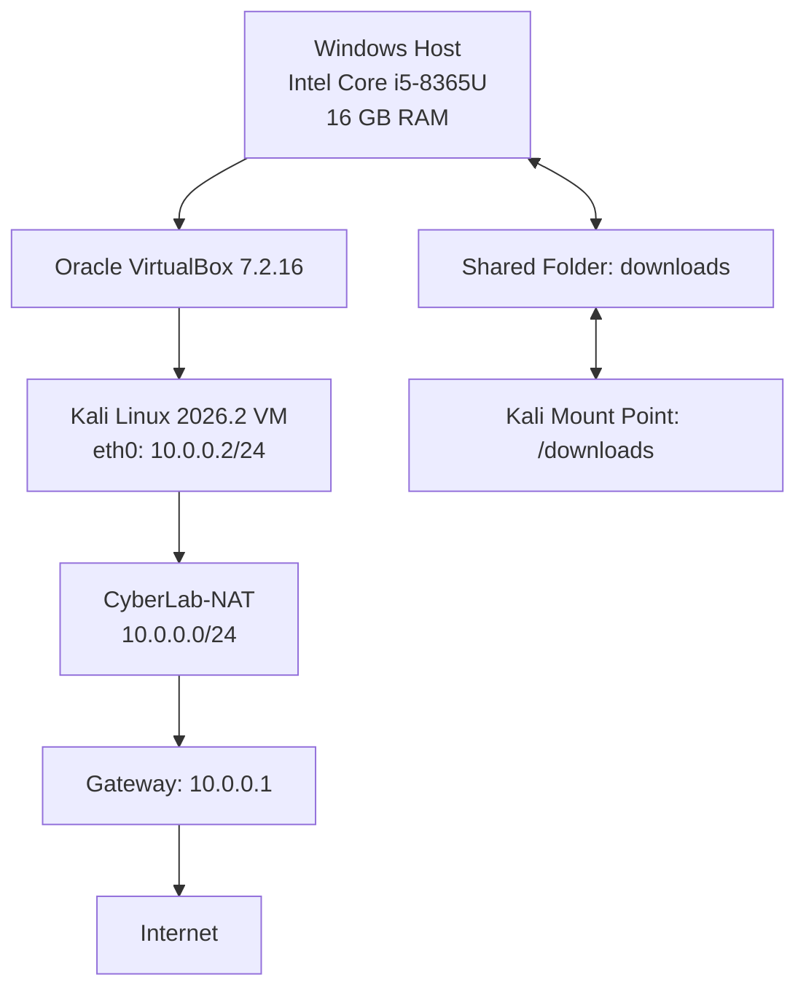

# Week 1: Practical Lab Environment Setup

## Project Overview

This project documents the setup and configuration of a cybersecurity practical laboratory using Oracle VirtualBox and Kali Linux. The objective was to establish an isolated virtual testing environment with network connectivity, host-to-guest file sharing, and the necessary configuration for future cybersecurity exercises.

## 1. Host System Specifications

| Component | Specification |
|---|---|
| Operating System | Windows |
| Processor | Intel Core i5-8365U @ 1.60GHz |
| CPU | 4 Cores / 8 Logical Processors |
| Installed RAM | 16 GB |
| System Type | 64-bit |
| Available Storage | 341 GB |
| Virtualization Software | Oracle VirtualBox 7.2.16 |

## 2. Virtual Machine Configuration

| Component | Configuration |
|---|---|
| Guest Operating System | Kali Linux 2026.2 |
| Kernel | 7.1.5+kali-amd64 |
| Network Interface | eth0 |
| IP Address | 10.0.0.2/24 |
| Network Mode | NAT Network |
| Shared Folder | /downloads |

## 3. Network Configuration

A custom VirtualBox NAT Network named `CyberLab-NAT` was created.

| Setting | Value |
|---|---|
| Network Name | CyberLab-NAT |
| IPv4 Network | 10.0.0.0/24 |
| Default Gateway | 10.0.0.1 |
| DHCP | Enabled |
| DHCP Server Address | 10.0.0.254 |
| DHCP Address Pool | 10.0.0.3 – 10.0.0.253 |
| IPv6 | Disabled |

The Kali Linux network interface was configured with the IP address `10.0.0.2/24`.

### Network Verification

The following command was used to verify the assigned IP address:

```bash
ip -br addr
```

The `eth0` interface returned:

```text
eth0  UNKNOWN  10.0.0.2/24
```

Internet connectivity was tested using:

```bash
ping -c 4 google.com
```

**Result:** 4 packets transmitted, 4 received, 0% packet loss.

## 4. Shared Folder Configuration

A shared folder was configured between the Windows host and Kali Linux guest.

- **Windows folder:** `C:\Users\user\OneDrive\Desktop\downloads`
- **Kali mount point:** `/downloads`
- **VirtualBox shared folder name:** `downloads`
- **Access:** Read and write
- **Auto-mount:** Enabled

The Kali Linux user was added to the `vboxsf` group to enable access to the shared folder.

```bash
sudo usermod -aG vboxsf "$USER"
```

After restarting the virtual machine, access was verified using:

```bash
ls -ld /downloads
```

A write test was performed:

```bash
touch /downloads/Networkwalks-test.txt
ls -l /downloads
```

The test file was successfully created and was visible from the Windows host.

## 5. VirtualBox Integration Settings

The following integration settings were enabled:

- Shared Clipboard: Bidirectional
- Drag and Drop: Bidirectional
- Shared Folder: Auto-mounted

## 6. Troubleshooting and Resolution

During network configuration, an IP address conflict was encountered because the initial DHCP server address overlapped with the intended Kali Linux static IP address (`10.0.0.2`).

### Resolution

The VirtualBox DHCP server address was changed to `10.0.0.254`, and its address pool was configured to allocate addresses from `10.0.0.3` to `10.0.0.253`.

The following command was used from Windows Command Prompt:

```cmd
"C:\Program Files\Oracle\VirtualBox\VBoxManage.exe" dhcpserver modify --network=CyberLab-NAT --server-ip=10.0.0.254 --lower-ip=10.0.0.3 --upper-ip=10.0.0.253 --enable
```

This reserved `10.0.0.2` for the Kali Linux VM and resolved the address conflict.

## 7. VM Snapshot

A snapshot was created after completing the initial laboratory configuration.

**Snapshot Name:** `CyberLab-Initial-Setup`

The snapshot preserves the configured virtual machine environment for recovery before future practical exercises.

## 8. Network Architecture



## 9. Evidence and Screenshots

The following screenshots were captured during the configuration and verification process:

1. `01-kali-ip-configuration.png`
2. `02-internet-connectivity.png`
3. `03-shared-folder-verification.png`
4. `04-shared-folder-write-test.png`
5. `05-nat-network-configuration.png`
6. `06-kali-snapshot.png`
7. `07-laptop-system-specifications.png`

Screenshots will be uploaded to this project's `screenshots` directory.

## 10. Key Learning Outcomes

Through this exercise, I gained practical experience in:

- Installing and configuring Kali Linux in Oracle VirtualBox.
- Creating and managing a custom NAT Network.
- Configuring a static IPv4 address in Linux.
- Understanding DHCP address allocation and IP conflicts.
- Verifying network connectivity and troubleshooting network issues.
- Configuring shared folders between Windows and Linux.
- Managing Linux group permissions.
- Creating virtual machine snapshots for recovery.

## Conclusion

The initial cybersecurity laboratory environment was successfully configured. Kali Linux has a working network connection, the assigned IP address is verified, the shared folder supports file transfer between the host and guest, and a recovery snapshot has been created.

This environment will serve as the foundation for subsequent practical cybersecurity exercises.

---

**Author:** Iwuji Daniel M.  
**Programme:** Cybersecurity Internship  
**Organization:** Networkwalks IT Solutions & Training  
**GitHub:** [@Iwujidaniel](https://github.com/Iwujidaniel)  
**LinkedIn:** [Iwuji Daniel](https://www.linkedin.com/in/Iwuji-daniel-696247272/)

*Disclaimer: All activities documented in this repository are conducted for educational purposes within an authorized laboratory environment.*
