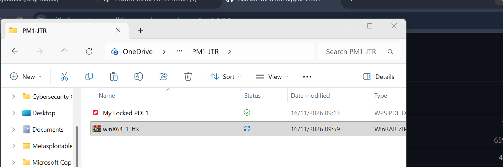
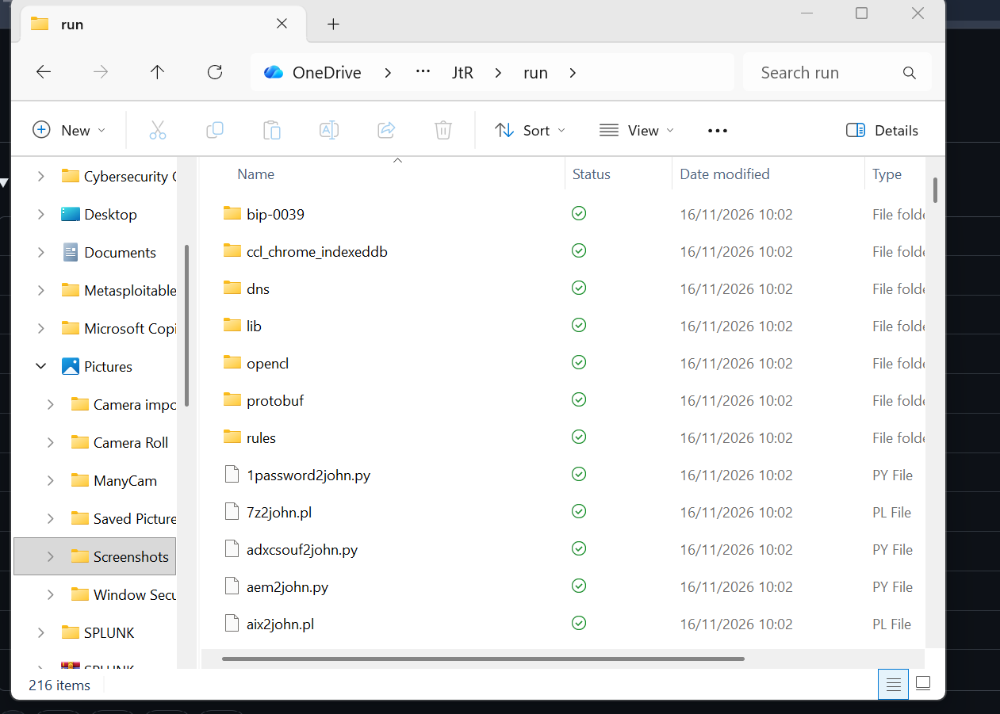
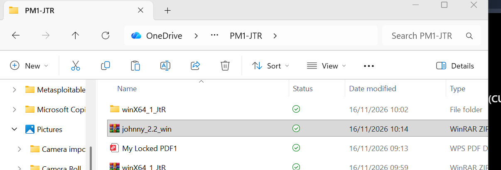
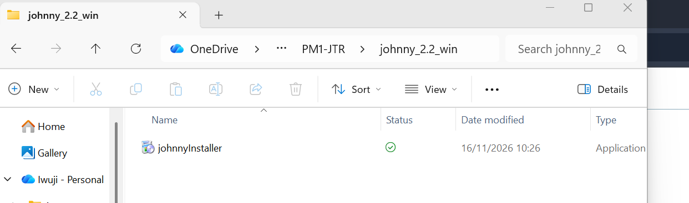
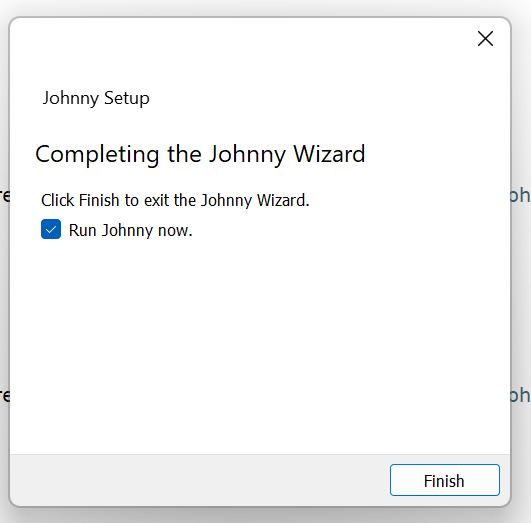
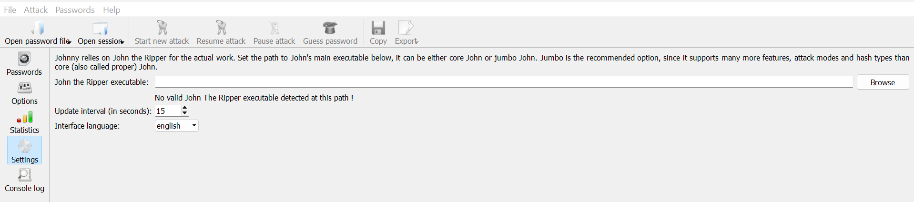
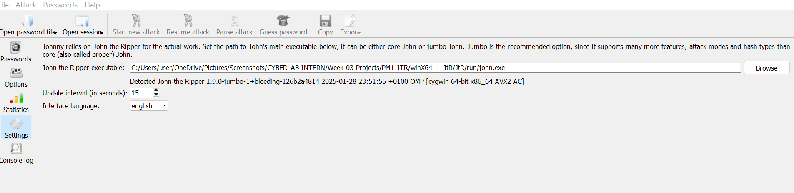
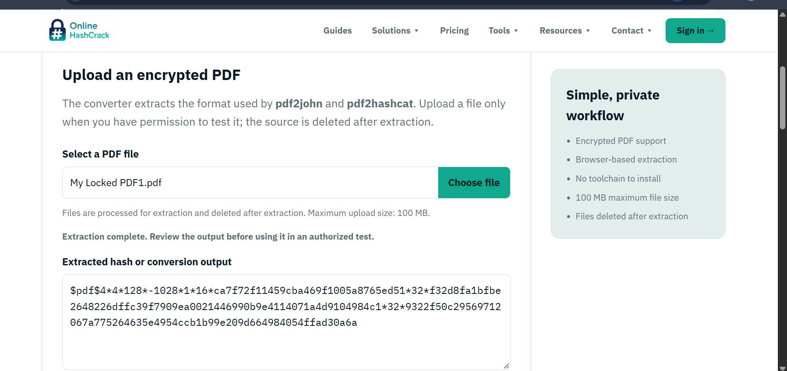
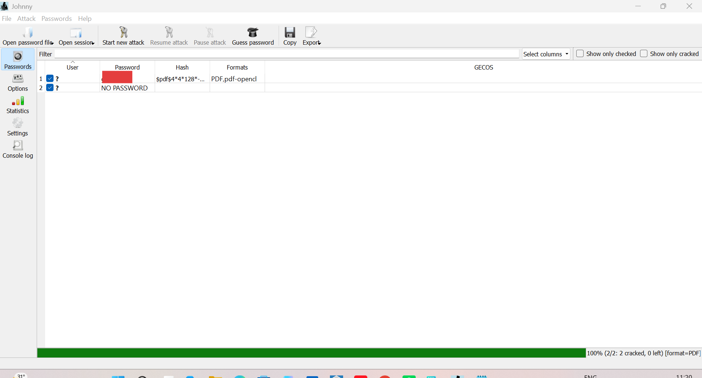

# Week 3 – PM1: Password Cracking with John the Ripper (JTR)

## Project Overview
This practical exercise focused on password recovery using John the Ripper (JTR) and its graphical interface, Johnny.

The objective was to extract a password hash from a password-protected PDF, configure Johnny to use the John the Ripper executable, perform a dictionary-based password attack, and verify successful password recovery.

## Tools Used
- John the Ripper 1.9.0 Jumbo
- Johnny 2.2
- Windows operating system
- Online PDF Hash Extractor
- Notepad
- Password-protected PDF supplied for the training lab

## Practical Steps Performed

1. Downloaded the Windows version of John the Ripper.
2. Extracted the downloaded archive and located the `john.exe` executable in the `run` folder.
3. Downloaded and installed Johnny 2.2.
4. Opened Johnny and configured it to use the John the Ripper executable.
5. Verified that Johnny successfully detected the installed John the Ripper version.
6. Uploaded the supplied password-protected PDF to the PDF hash extraction tool.
7. Extracted the PDF password hash and saved it locally in `hash1.txt`.
8. Loaded the hash file into Johnny.
9. Started a dictionary-based password recovery attack.
10. Successfully recovered the password, with Johnny reporting 100% completion and 2/2 hashes cracked.
11. Used the recovered password to open the protected PDF and verified that its contents were accessible.

## Results
The password recovery exercise was successful.

Johnny successfully processed the supplied PDF hash and recovered the password. The protected PDF subsequently opened successfully using the recovered password.

## Evidence

The screenshots below document the practical exercise in chronological order.

### 1. John the Ripper Download

### 2. Extracted John the Ripper Files

### 3. Johnny Download

### 4. Johnny Application

### 5. Johnny Installation

### 6. Johnny Opened After Installation

### 7. Johnny Settings

### 8. Successful John the Ripper Configuration

### 9. PDF Hash Extraction

### 10. Successful Password Recovery

### 11. Successfully Unlocked PDF

## Key Learning Outcomes
- Installing and configuring John the Ripper on Windows.
- Using Johnny as a graphical interface for John the Ripper.
- Understanding password hashes and PDF hash extraction.
- Performing dictionary-based password recovery in an authorised lab.
- Understanding the importance of wordlists in password auditing.
- Verifying password recovery by opening the protected PDF.

## Conclusion
This practical provided hands-on experience with John the Ripper and Johnny for password recovery. It improved my understanding of password hash extraction, tool configuration, dictionary-based attacks, and password verification.

**Scope:** This exercise was performed on a password-protected PDF supplied for the authorised cybersecurity training lab.
