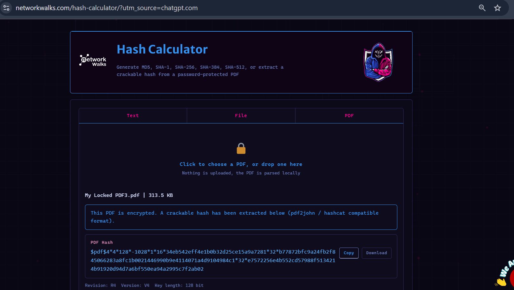
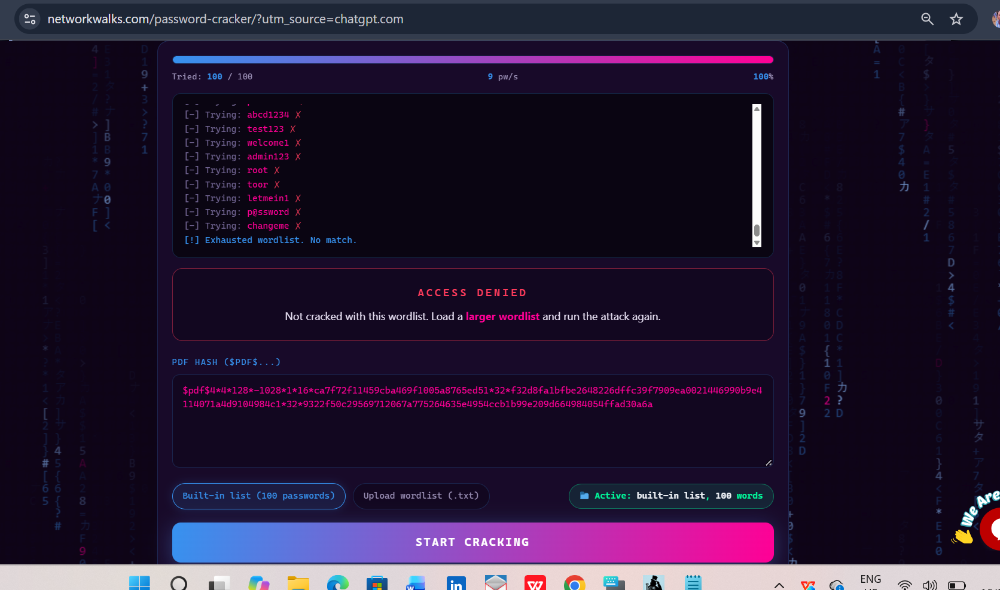
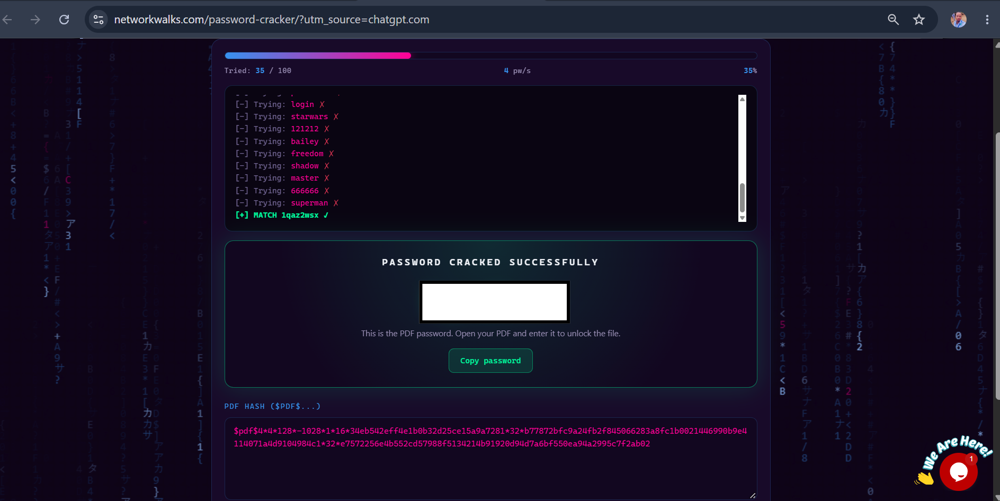

## Evidence

The following screenshots document the practical exercise:

### 1. PDF Hash Extraction

### 2. Initial Unsuccessful Attempt

### 3. Successful Password Recovery

### 4. Successfully Unlocked PDF

## Key Learning Outcomes
- Understanding PDF password hashes.
- Extracting hashes from password-protected PDF files.
- Using online hash and password-cracking tools in an authorised lab exercise.
- Understanding dictionary-based password attacks and wordlist limitations.
- Verifying successful password recovery by opening the protected PDF.

## Conclusion
This practical provided hands-on experience with PDF hash extraction and dictionary-based password recovery using Networkwalks tools. It also demonstrated that password recovery depends on whether the password is represented in the available wordlist.

**Scope:** This exercise was performed on password-protected PDF files supplied for the authorised training lab.
